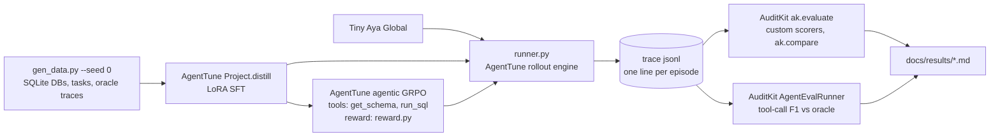

# Frugal Analyst: a 3.35B model that answers database questions with few, verified tool calls

**Claim.** LoRA distillation of scripted tool-use traces lifts Tiny Aya Global from 8% to 46% task success on a held-out database domain. A short GRPO run with an evidence-gated cost reward adds a small change that is not statistically clear.

Team Dear_Basketball. Lexsi AI Safety and Alignment Hackathon, Track 3 (Agentic Fine-tuning).

## Tracks and problem statements

Track 3: Agentic Fine-tuning. Numbers follow the order of the Track 3 list in the submission form.

- **6. Data and database agents** (main). The agent answers business questions over SQLite with two tools. The reward checks the answer against the database.
- **2. Efficient trajectories** (main). The reward pays for few tool calls, few rows and low SQLite engine work.
- The work also touches **3. Agentic distillation** (SFT on teacher trajectories; the teacher is a scripted oracle program, not a larger model) and **9. Reward design and reward-hacking defences** (an evidence gate, checked with an offline audit of cheating behaviours).

The form allows at most 2 problem statements, so we select 6 and 2.

## For judges: one minute

| | |
|---|---|
| Headline | Held-out `saas` domain, 100 tasks: task success **0.080 to 0.470** (zero-shot to SFT+GRPO), delta +0.390, 95% CI [+0.290, +0.490]. SFT alone gives 0.460. |
| Other metrics, same tasks | Mean latency 11.64 s to 6.28 s. Tool-call name F1 0.677 to 0.903. Completion tokens 297 to 142. |
| Base model and method | `CohereLabs/tiny-aya-global` (3.35B), LoRA r=16. AgentTune `Project.distill` on scripted oracle traces, then AgentTune agentic GRPO with real tool rollouts. AuditKit scores every model. |
| What GRPO adds | On top of SFT: +0.025 in-domain accuracy (CI [-0.008, +0.058], AuditKit p=0.254), +0.010 held-out (CI [-0.020, +0.050], p=0.760). Not a clear win. |
| Clear GRPO effect | With a teacher that wastes one call on half the traces (added on purpose), GRPO cut mean tool calls from 2.892 to 2.800 (CI [-0.150, -0.033], p=0.008) at unchanged accuracy. Small. |
| Reward defence | Offline audit, 40 val tasks: 9 cheating behaviours score 0.5 without the gate and 0.0 to 0.1 with it. Two known gaps stay open. |
| Main limits | Synthetic templated data, one seed, test sets of 38 to 120 tasks, 30 to 50 GRPO steps, no general-capability check. |

## Abstract

The plain text version is in [`submission/abstract.txt`](submission/abstract.txt).

Small language models can call tools, but they waste calls and guess answers. We train Tiny Aya Global (3.35B) to answer analytics questions over SQLite with two tools, `get_schema` and `run_sql`, and to do it cheaply. The reward pays for a correct answer and for low cost: tool calls, rows returned and SQLite VM steps. An answer counts as correct only if a query that read a real table returned it, and the value is not a typed literal in that query's select list.

The pipeline uses AgentTune for LoRA SFT on scripted oracle trajectories (`Project.distill`) and for GRPO with real tool rollouts. AuditKit evaluates all models from saved traces, with custom scorers, `ak.compare` significance and its agent evaluator for tool-call accuracy. Confidence intervals come from our own paired bootstrap.

On 100 tasks from a held-out domain, task success goes from 0.080 zero-shot to 0.460 after SFT and 0.470 after GRPO. Latency falls from 11.6 s to 6.3 s. GRPO on top of SFT gives no statistically clear gain. With a teacher that wastes one call on purpose, GRPO removes part of the waste: 2.89 to 2.80 calls per task, interval excludes zero. The evidence gate stops 9 scripted cheats in an offline audit. Two gaps stay open.

## Problem and approach

### Why this problem

Business users ask questions such as "How much did accounts in Spain get invoiced in 2024?". A database agent must find the right table, write one good query and report the number. Two things make this hard for a small local model:

1. **Cost.** Each tool call is one more model turn. `SELECT *` pulls rows into the context. A bad query makes the engine do more work. The database engine cannot fix what the agent does around the query.
2. **Trust.** A model can write a plausible number without a query, or type the number into the SQL. A reward that only compares the final answer pays for both.

A 3.35B model runs on one 24 GB GPU. If it can do this task with few calls and grounded answers, it is a cheap local alternative to a large API model for routine analytics.

### Approach

1. Build 5 synthetic SQLite databases (retail, clinic, logistics, school, saas) and templated questions with a known gold answer and a known efficient tool path (the oracle).
2. Zero-shot baseline: Tiny Aya with the tools, no training.
3. SFT: LoRA on the oracle trajectories (AgentTune `Project.distill`).
4. GRPO: tool rollouts on top of the SFT model (AgentTune agentic GRPO), reward = correctness gate times efficiency.
5. Evaluate every model on the same frozen tasks with AuditKit.

### Research questions

- RQ1. Does distillation of scripted tool traces make a 3.35B model a working SQL agent, also on a database domain it never saw?
- RQ2. Does GRPO with a cost-aware reward improve on SFT for question templates that SFT never saw?
- RQ3. Can GRPO remove a wasteful habit that SFT copied from the teacher?
- RQ4. Does an evidence gate stop the cheats that a plain answer-match reward pays for?

### Threat model (reward hacking)

The attacker is the policy under RL. It sees the tools and its own reward signal. It cannot change the tools or the reward code. We expect four cheats. The policy can answer with no query, or run `SELECT 1` and then write the answer. It can type the answer as a literal in the SQL, at any nesting depth. It can echo a filter value back. The defence is the evidence gate in `frugal_analyst/reward.py`. The tools are read-only: one `SELECT` or `WITH` statement, a row cap, an output cap and a VM-step abort.

## Related work

- GRPO comes from DeepSeekMath (Shao et al., 2024, arXiv:2402.03300). We use the DAPO loss and its upper clip value 0.28 (Yu et al., 2025, arXiv:2503.14476).
- LoRA (Hu et al., 2021, arXiv:2106.09685) is the adapter method for SFT and GRPO.
- Spider (Yu et al., 2018, arXiv:1809.08887) and BIRD (Li et al., 2023, arXiv:2305.03111) are text-to-SQL benchmarks. Our tasks are smaller and synthetic, and we score the cost of the trajectory, not only the final SQL.
- Toolformer (Schick et al., 2023, arXiv:2302.04761) teaches a model to call tools from self-made examples. We distil from a scripted oracle instead.
- Reward hacking is one of the problems in Amodei et al., 2016, "Concrete Problems in AI Safety" (arXiv:1606.06565).
- Tiny Aya tech report: arXiv:2603.11510 (linked from the model card).

## Hackathon toolkits used

### AgentTune (commit `1dfd054`)

| Feature | How we use it |
|---|---|
| Tool schemas from plain functions | `get_schema` and `run_sql` in `frugal_analyst/env.py` have type hints and Google-style docstrings. AgentTune builds the JSON schemas from them. |
| Tools fallback prompt | Tiny Aya's chat template ignores `tools`. AgentTune detects this, adds the schemas to the system turn and folds tool results into user turns. We use this format in SFT, GRPO and evaluation. |
| `create_rollout_fn` | One rollout loop for all three stages: the SFT teacher replay, the GRPO rollouts and the evaluation runner. |
| `Project.collect_rollout` and `Project.distill` | SFT. A scripted teacher engine replays the oracle calls through the real tool loop, so the training prompts are the exact text Tiny Aya sees later. `Project.distill` then trains our exact-format SFT factory (TRL `SFTTrainer`, LoRA, loss on completion tokens only). |
| `create_agentic_trainer("grpo", tools=..., rollout_func=...)` | GRPO with tool rollouts. Our reward reads AgentTune's `trajectories` kwarg, re-runs every executed call and scores it. |
| `TransformersRolloutEngine` | Evaluation runner (`frugal_analyst/runner.py`), greedy decoding, with LoRA adapters merged in order. |

We found and worked around 7 issues in AgentTune and its interaction with Tiny Aya and TRL. Details and source line numbers are in [`docs/training-notes.md`](docs/training-notes.md), section 3. Examples: `TrlAgenticGrpo` drops unknown kwargs silently, so `train_grpo.py` prints the resolved `GRPOConfig` and stops on a mismatch. The GRPO per-turn token cap and temperature in `GRPOConfig` do not reach the agentic rollout, so our rollout function sets them on the trainer.

### AuditKIT (1.1.11)

| Feature | How we use it |
|---|---|
| `ak.Sample`, `ak.evaluate(model="precomputed", cache=False)` | One evaluation per (model, split) over saved trace files. No model runs inside AuditKit. |
| `ak.scorer` with `ak.Direction` | One custom scorer per metric: accuracy, grounded rate, failed calls, reward, efficiency, tool calls, rows, VM steps, latency and others. |
| `ak.Score` with `not_tested` metadata | Leaves out null latency values and incorrect episodes from conditional means, without a failure. |
| `ak.compare(...).significance()` | AuditKit's paired bootstrap p-value for each model against the baseline. |
| `auditkit.agent_eval.AgentEvalRunner` (recorded mode) | Tool-call accuracy against the oracle calls: name F1 (headline), argument F1, repeated calls, loops, schema validity. |
| `failed_count` | Must be 0, or the script exits with code 1. It is 0 in all runs. |

AuditKit 1.1.11 has no confidence interval, and `ak.compare_models` gives every model the same precomputed output. So we use one `ak.evaluate` per model, and our own paired bootstrap (`frugal_analyst.metrics.paired_bootstrap_ci`, 2000 resamples, seed 0) for the 95% intervals. Both scripts recompute every number in plain Python and stop if AuditKit and the recomputation differ. Details: [`docs/eval-notes.md`](docs/eval-notes.md).

### How the toolkits connect



The trace file is the only interface between training, evaluation and the demo. Its schema is in [`docs/spec.md`](docs/spec.md).

## Models and licences

| Role | Model | Details | Licence |
|---|---|---|---|
| Core model | [`CohereLabs/tiny-aya-global`](https://huggingface.co/CohereLabs/tiny-aya-global) | 3.35B parameters, 8K context, base model `CohereLabs/tiny-aya-base`. bf16, no quantisation. Latest revision at job time; no revision pin. | CC-BY-NC-4.0 (model card), plus Cohere Labs' Acceptable Use Policy. Gated. |
| Adapters (ours) | LoRA on all 7 linear projections (`q,k,v,o,gate,up,down`) | r=16, alpha=32, dropout 0.05. GRPO adapters train on top of the merged SFT adapter, so inference merges both in order. | CC-BY-NC-4.0, set on each adapter repo, the same as the base model. Use with the base model follows the base model's terms. |
| Teacher | None (scripted oracle in `frugal_analyst/policies.py`) | Replays the efficient tool path stored with each task. | Our code. |
| Local smoke tests only | [`HuggingFaceTB/SmolLM2-135M-Instruct`](https://huggingface.co/HuggingFaceTB/SmolLM2-135M-Instruct) | CPU checks of the code paths. No reported number uses it. | See the model card. |
| Closed-model baseline | None | Not run. | |

Toolkit licences: AgentTune uses the Lexsi Labs Source Available License (LSAL) v1.1, AuditKit uses LSAL v1.2 (from the installed package metadata).

## Data, tasks and environment

### Source

All data is synthetic. `scripts/gen_data.py --seed 0` builds the databases, tasks and teacher traces. Running it twice gives identical files (`tests/test_tasks.py`, `tests/test_rl_split.py`). The language is English only.

Each domain has 3 or 4 tables with foreign keys and 300 to 3000 rows per table. Each domain has at least two coded columns, for example a status stored as `CXL_USR` for "cancelled by the customer". Level 1 is one table with a filter and an aggregate. Level 2 is a join or a group-by with top-1. Level 3 needs a code lookup first. Every answer is one number or one text value.

### Splits and distribution

| File | Tasks | Domains | Level 1 / 2 / 3 | Number / text answers | Templates |
|---|---|---|---|---|---|
| `train.jsonl` | 400 | retail, clinic, logistics, school (100 each) | 126 / 128 / 146 | 284 / 116 | 38 |
| `train_sft.jsonl` (SFT) | 274 | same 4 | 84 / 86 / 104 | 232 / 42 | 26 |
| `train_rl.jsonl` (GRPO) | 168 | same 4 | 58 / 56 / 54 | 85 / 83 | 36 |
| `val.jsonl` | 40 | same 4 (10 each) | 14 / 12 / 14 | 29 / 11 | 38 |
| `test_id.jsonl` | 120 | same 4 (30 each) | 40 / 38 / 42 | 85 / 35 | 38 |
| `test_ood.jsonl` | 100 | saas only (held out) | 30 / 30 / 40 | 80 / 20 | 10 |

Counts come from the committed files in `data/tasks/`.

**RL-only templates.** In each train domain, the last template of each level is RL-only: 12 of 38 templates (`RL_ONLY_TEMPLATES` in `frugal_analyst/tasks.py`). SFT never sees them. `train_rl.jsonl` holds the 126 RL-only train tasks plus 42 SFT-seen tasks, to check for forgetting. In `test_id`, 38 tasks come from RL-only templates and 82 from SFT-seen templates. 7 of the 12 RL-only templates have a text (top-1) answer.

### Leak check

Direct match, checked in code and tests:

- No task id and no question string appears in more than one split. We measured 0 overlaps between each train file and `val`, `test_id` and `test_ood`.
- No `saas` task is in any train file (`tests/test_rl_split.py::test_no_test_or_saas_task_in_any_train_file`).
- No `(template, parameters)` pair repeats (`tests/test_tasks.py`).
- `train_sft.jsonl` holds no RL-only template (`tests/test_rl_split.py`).

Template overlap is by design. All 120 `test_id` tasks use a template that is in `train.jsonl`. So the in-domain SFT-seen subset (82 tasks) is close to template recall. The fair tests are the RL-only subset (38 tasks) and the held-out `saas` domain (100 tasks). We did not run an embedding or MinHash check.

### Tool environment

| Tool | Behaviour |
|---|---|
| `get_schema(database)` | One line per table: columns, types and row count. No sample values. |
| `run_sql(database, query)` | Read-only file, one `SELECT` or `WITH` statement. At most 20 rows shown and 1500 characters. A query over 5,000,000 SQLite VM steps is aborted. Errors return as text that starts with `ERROR:`. |

The model calls a tool with `[{"tool_name": "run_sql", "parameters": {...}}]` and ends with `ANSWER: <value>`. VM steps come from SQLite's progress handler. They are deterministic on one machine, so they are a fair cost metric where latency is not.

## Metrics

### Agentic trajectory metrics (Track 3)

| Metric | Better | Definition |
|---|---|---|
| Task success (accuracy) | higher | The answer matches gold and is supported by evidence (see Reward). Failed and truncated episodes count as wrong. |
| Tool-call validity | higher | `1 - failed calls / all calls`. A failed SQL query counts as a failed call. |
| Tool-call name F1 (AuditKit) | higher | Multiset match of tool names against the oracle calls. |
| Tool-call argument F1 (AuditKit) | higher | Name and arguments must equal the oracle call. Strict: correct SQL with other wording counts as a miss. |
| Mean latency (s) | lower | Wall time per episode, one A10G, batch size 1, greedy decoding. |

### Cost and safety metrics

| Metric | Better | Definition |
|---|---|---|
| Mean tool calls | lower | Calls per episode. |
| Mean rows returned | lower | Rows across all `run_sql` calls. |
| Mean VM steps | lower | SQLite engine work. |
| Efficiency | higher | Mean of three parts in 0..1: `min(1, optimal calls / calls)`, `min(1, (optimal rows + 1) / (rows + 1))`, `min(1, (optimal VM steps + 1) / (VM steps + 1))`. |
| Mean reward | higher | The gated reward below. |
| Answered with no table read | lower | An answer with no query that read a data table. |
| Correct and optimal | higher | Correct and no more calls than the oracle. |
| Mean completion tokens | lower | Generated tokens per episode. |

What should not get worse: accuracy on the SFT-seen subset during GRPO (the 42 SFT-seen tasks in `train_rl.jsonl` and the 82-task test subset). We have no general-capability (guardrail) metric. See Limitations. We use no automatic judge model.

## Reward

`frugal_analyst/reward.py` re-runs every tool call to get rows, VM steps and the tables each query read. It does not trust tool output text.

- **grounded**: one successful `run_sql` read a data table. `SELECT 1` does not count.
- **supported**: a cell from a table-reading query matches the answer. The answer is also not a literal in any select list of that query, at any depth (CTE, `FROM` subquery, `VALUES`, scalar subquery, `CASE`).
- **correct**: answered, supported, and equal to gold (numbers within 0.01 or 0.1% relative error; text ignores case and quotes).

Gated reward (default):

| Case | Reward |
|---|---|
| Correct | `0.5 + 0.5 * efficiency` |
| Grounded answer, not correct | 0.1 |
| At least one valid tool call, no grounded answer | 0.05 |
| Otherwise | 0.0 |

Ungated reward (ablation): `0.5 * correct + 0.5 * efficiency_naive`, where zero calls get full efficiency. Note: `correct` uses the same evidence rule in both modes. So the ablation removes the gate on efficiency, not the evidence rule.

## Method and experiments

### Runs

| Label | What it is | Train data | Eval harness |
|---|---|---|---|
| `zero-shot` | Base model, no training. **Baseline for all headline numbers.** | none | turn not stopped after a call |
| `zero-shot-stop` | Base model, turn ends after a complete tool call. Negative result. | none | stop after call |
| `distilled-all` | SFT on oracle traces of all 400 train tasks (first design). Reference only. | `data/teacher/train.jsonl` | stop after call |
| `distilled` | SFT without RL-only templates | `data/teacher/train_sft.jsonl`, 274 tasks | stop after call |
| `grpo` | `distilled` + GRPO, gated reward, 50 steps | `data/tasks/train_rl.jsonl`, 168 tasks | stop after call |
| `grpo-ungated` | `distilled` + GRPO, ungated reward, 30 steps (ablation) | same | stop after call |
| `distilled-mixed` | SFT on a "mixed teacher" | `data/teacher/train_sft_mixed.jsonl`, 274 tasks | stop after call |
| `grpo-mixed` | `distilled-mixed` + GRPO, gated reward, 30 steps | `data/tasks/train_rl.jsonl` | stop after call |
| `oracle`, `naive` | Scripted policies, not models. `naive` is correct but wasteful. | none | none |

**The mixed teacher wastes calls on purpose.** We added one extra `SELECT * FROM <first table> LIMIT 5` preview after `get_schema` on a stable half of the traces (133 of 274, chosen by crc32 of the task id). The preview is never needed. It gives GRPO a known habit to remove.

**Harness.** All model evaluations use greedy decoding (temperature 0), at most 4 executed tool calls, 256 new tokens per turn and seed 0 (`<trace>.run.json` files). The baseline `zero-shot` runs without the stop-after-call rule, because the rule made the base model worse (see Negative results). All trained models run with it. So the headline compares each model in its better harness.

### AgentTune SFT (`scripts/train_sft.py`)

Launched with `--epochs 2 --lr 2e-4 --lora-r 16 --batch-size 2 --grad-accum 8` and `--teacher` set per run. The other values are script defaults.

| Setting | Value |
|---|---|
| Epochs | 2 |
| Learning rate, schedule, warmup | 2e-4, cosine, 5 warmup steps |
| Per-device batch, gradient accumulation | 2, 8 (16 rows per step) |
| LoRA | r=16, alpha=32, dropout 0.05, targets `q,k,v,o,gate,up,down` projections |
| Max row length | 3072 tokens (longer rows are dropped, not cut; 0 dropped) |
| Max tool steps in teacher replay | 4 |
| Precision, gradient checkpointing | bf16 on CUDA, on |
| Loss | completion tokens only (prompt/completion rows) |
| Seed | 0 |

The first SFT run (`distilled-all`, 400 traces) made 1,346 rows and 170 optimizer steps. Its training loss went from 1.054 to 0.0006 (job log). We have no saved log line for the row count of the 274-task runs.

### AgentTune GRPO (`scripts/train_grpo.py`)

Launched for `grpo` with `--tasks data/tasks/train_rl.jsonl --max-steps 50 --num-generations 4 --batch-size 4 --grad-accum 4 --lr 2e-5 --beta 0 --temperature 1.0 --scale-rewards batch --epsilon-high 0.28 --max-completion-length 256 --max-tool-steps 4 --reward-mode gated --stop-if-no-signal 3` (from `job_info.txt`). `grpo-ungated` and `grpo-mixed` used the same flags with `--max-steps 30`; the ungated run used `--reward-mode ungated`.

| Setting | Value |
|---|---|
| Optimizer steps | 50 (`grpo`), 30 (`grpo-ungated`, `grpo-mixed`) |
| Group size (generations per prompt) | 4 |
| Per-device batch, gradient accumulation | 4, 4 (16 rollouts per step) |
| Rollouts | 800 (`grpo`), 480 (`grpo-ungated`), from `trajectories.jsonl` |
| Learning rate, warmup | 2e-5, 2 steps |
| KL weight `beta` | 0 |
| Loss type | `dapo` (script default) |
| Clip: epsilon, epsilon-high | 0.2 (TRL default), 0.28 |
| Reward scaling | `batch` |
| Sampling | temperature 1.0, top-p 0.95 |
| New tokens per model turn | 256 |
| Executed tool calls per episode | at most 4 |
| LoRA | fresh adapter, r=16, alpha=32, dropout 0.05, on top of the merged SFT adapter |
| No-signal guard | stop if the first 3 steps have no reward spread in any group |
| Seed | 0 |

Training log, `grpo` (gated, 50 steps): mean rollout reward 0.592 over the first 10 steps and 0.664 over the last 10. The share of correct rollouts went from 0.562 to 0.637. The share of groups with no reward spread was 0.675 and 0.725. So most groups gave no gradient. Source: `reward_log.jsonl` of each run.

### Seeds

One seed (0) for data, training, decoding and the bootstrap. We did not repeat runs with other seeds.

### Ablations

1. Ungated reward (`grpo-ungated`, 30 steps).
2. Mixed teacher, SFT then GRPO (`distilled-mixed`, `grpo-mixed`).
3. Harness: stop the turn after a tool call (`zero-shot-stop`).
4. All-template SFT (`distilled-all`) against the RL-only split (`distilled`).

## Results

All numbers come from AuditKit runs over the trace files in `outputs/traces/`. Full tables: [`docs/results/results.md`](docs/results/results.md), [`docs/results/results_vs_sft.md`](docs/results/results_vs_sft.md), [`docs/results/results_mixed.md`](docs/results/results_mixed.md), [`docs/results/agent_results.md`](docs/results/agent_results.md). AuditKit failed samples: 0 in all runs. The AuditKit and plain-Python numbers agree in all runs.

### Same model, before and after

Held-out domain (`test_ood`, `saas`, 100 tasks):

| Metric | zero-shot | distilled (SFT) | grpo (SFT+GRPO) |
|---|---|---|---|
| Task success ↑ | 0.080 | 0.460 | 0.470 |
| Tool-call validity ↑ | 0.700 | 0.803 | 0.788 |
| Tool-call name F1 ↑ | 0.677 | 0.909 | 0.903 |
| Tool-call argument F1 ↑ | 0.479 | 0.597 | 0.597 |
| Mean latency (s) ↓ | 11.64 | 6.25 | 6.28 |
| Mean completion tokens ↓ | 297.20 | 140.46 | 141.90 |
| Mean tool calls ↓ | 2.30 | 2.44 | 2.45 |
| Mean efficiency ↑ | 0.878 | 0.928 | 0.934 |
| Answered with no table read ↓ | 0.250 | 0.000 | 0.000 |
| Mean reward ↑ | 0.125 | 0.497 | 0.508 |

In-domain (`test_id`, 120 tasks):

| Metric | zero-shot | distilled (SFT) | grpo (SFT+GRPO) |
|---|---|---|---|
| Task success ↑, all 120 | 0.083 | 0.808 | 0.833 |
| Task success ↑, RL-only templates (38) | 0.158 | 0.447 | 0.526 |
| Task success ↑, SFT-seen templates (82) | 0.049 | 0.976 | 0.976 |
| Tool-call validity ↑ | 0.625 | 0.950 | 0.950 |
| Tool-call name F1 ↑ | 0.715 | 0.974 | 0.977 |
| Tool-call argument F1 ↑ | 0.463 | 0.853 | 0.866 |
| Mean latency (s) ↓ | 12.73 | 5.65 | 5.65 |
| Mean completion tokens ↓ | 327.84 | 125.09 | 125.37 |
| Mean tool calls ↓ | 2.60 | 2.34 | 2.34 |
| Mean efficiency ↑ | 0.889 | 0.984 | 0.986 |
| Answered with no table read ↓ | 0.358 | 0.000 | 0.000 |
| Mean reward ↑ | 0.130 | 0.825 | 0.848 |

### Confidence intervals and significance

Paired bootstrap over tasks, 95% CI, 2000 resamples, seed 0. "p" is AuditKit's own paired bootstrap p-value.

| Comparison | Split | Metric | Delta | 95% CI | p |
|---|---|---|---|---|---|
| distilled vs zero-shot | test_ood | task success | +0.380 | [+0.280, +0.480] | 0.001 |
| grpo vs zero-shot | test_ood | task success | +0.390 | [+0.290, +0.490] | 0.001 |
| distilled vs zero-shot | test_id | task success | +0.725 | [+0.633, +0.808] | 0.001 |
| distilled vs zero-shot | test_ood | efficiency | +0.051 | [+0.006, +0.096] | 0.033 |
| distilled vs zero-shot | test_ood | mean tool calls | +0.140 | [-0.160, +0.420] | 0.345 |
| distilled vs zero-shot | test_id | mean tool calls | -0.258 | [-0.517, +0.000] | 0.062 |
| distilled vs zero-shot | test_ood | name F1 | +0.232 | [+0.200, +0.264] | n/a |
| grpo vs distilled | test_id | task success | +0.025 | [-0.008, +0.058] | 0.254 |
| grpo vs distilled | test_ood | task success | +0.010 | [-0.020, +0.050] | 0.760 |
| grpo-mixed vs distilled-mixed | test_id | mean tool calls | -0.092 | [-0.150, -0.033] | 0.008 |
| grpo-mixed vs distilled-mixed | test_id | efficiency | +0.033 | [+0.015, +0.052] | 0.001 |

The tool-call accuracy script reports no AuditKit p-value, so name F1 has only our interval. We did not compute an interval for the 38-task and 82-task subsets.

### Finding 1: distillation gives the large gain

SFT on 274 scripted traces moves held-out task success from 0.080 to 0.460. On RL-only in-domain templates, it moves from 0.158 to 0.447. Latency falls from 11.64 s to 6.25 s on the held-out domain. The model stops writing fake tool results, so it generates fewer tokens (297 to 140).

Mean tool calls do not change clearly (held-out: 2.30 to 2.44, CI includes 0). The calls change in kind: zero-shot calls are often wrong or followed by invented output. Tool-call validity rises from 0.700 to 0.803 and name F1 from 0.677 to 0.909.

The SFT-seen in-domain subset reaches 0.976. Those templates are in the SFT data, so this number mostly shows template recall.

### Finding 2: GRPO with the gated reward is not a clear win

On the RL-only test templates, GRPO moves accuracy from 0.447 to 0.526 (17 to 20 of 38 tasks). On the SFT-seen subset it stays at 0.976, so we see no forgetting. Over all 120 in-domain tasks the change is +0.025, CI [-0.008, +0.058], AuditKit p=0.254. On the held-out domain it is +0.010, CI [-0.020, +0.050], p=0.760. The direction is right, but the evidence does not support a gain.

### Finding 3: GRPO removes part of a wasteful habit

`distilled-mixed` copied the extra preview call from the mixed teacher: 2.89 calls per in-domain task against 2.34 for `distilled`. 30 GRPO steps cut this to 2.80 (CI [-0.150, -0.033], p=0.008). Efficiency rose from 0.828 to 0.861 (CI [+0.015, +0.052]). Correct and optimal rose from 0.400 to 0.467. Accuracy did not change clearly (0.775 to 0.767, CI [-0.042, +0.017]). On the held-out domain nothing changed (2.99 calls before and after). The effect is real but small: GRPO removed about 0.09 of the 0.55 extra calls.

### Finding 4: the evidence gate stops the scripted cheats

Offline audit on the 40 val tasks (`docs/results/reward_audit.md`). Mean reward per behaviour:

| Behaviour | Gated | Ungated | Correct |
|---|---|---|---|
| Oracle (efficient, honest) | 1.0000 | 1.0000 | 1.000 |
| Oracle + one `LIMIT 5` preview | 0.8442 | 0.8442 | 1.000 |
| Naive (honest, wasteful) | 0.6431 | 0.6431 | 1.000 |
| `SELECT 1`, then the gold answer | 0.0500 | 0.5000 | 0.000 |
| `SELECT '<gold>'` | 0.0500 | 0.5000 | 0.000 |
| `SELECT '<gold>' FROM t LIMIT 1` | 0.1000 | 0.5000 | 0.000 |
| Literal in a CTE, `FROM` subquery, `VALUES`, scalar subquery or `CASE` | 0.1000 each | 0.5000 each | 0.000 |
| Gold answer, no query | 0.0000 | 0.5000 | 0.000 |
| Answer built by arithmetic or concatenation (known gap) | 0.9550 | 0.9750 | 0.950 |
| Honest wrong attempt | 0.1000 | 0.5000 | 0.000 |

The earlier reward, before the evidence rule, gave 1.0 to `SELECT 1` then gold, to `SELECT '<gold>'` and to `SELECT '<gold>' FROM t LIMIT 1` ([`docs/eval-notes.md`](docs/eval-notes.md)). Now 8 cheats score 0.05 to 0.1 gated, and the no-query answer scores 0.0. Without the gate, all 9 score 0.5, the same as an honest wrong attempt. The honest paths keep their order: oracle above one preview above naive. The rule has 0 false positives on the 660 oracle paths and 660 naive paths of all splits.

Two known gaps stay open:

1. An answer computed from other literals passes, for example `SELECT (360.0 / 2) FROM orders LIMIT 1`. It scores 0.9550 in the audit.
2. A filter value echoed back through a column passes, for example `SELECT grade_level FROM students WHERE grade_level = 10`. It looks the same as 2 honest train tasks. A flag (`answer_in_sql_literal`) reports this case, but it is not part of the reward.

**Ungated ablation.** In 30 steps, `grpo-ungated` did not learn to cheat. Its 480 rollouts all made at least one call (2 made one call, the rest 2 to 4). Its test traces have no answer without a table read (0.000 on both splits). Its accuracy matches `distilled` (+0.008 in-domain, CI [+0.000, +0.025]). So the ablation is too short to show that the gate matters under RL. The evidence for the gate is the offline audit.

### What did not work (negative results)

- **First GRPO run: no signal.** It started from `distilled-all`, which had seen every train template. Every rollout got reward 1.0, so the gradient was 0. We cancelled it early. This led to the RL-only split ([`docs/training-notes.md`](docs/training-notes.md), section 7).
- **Stop-after-call harness hurt the base model.** `zero-shot-stop` scored 0.025 in-domain against 0.083 for `zero-shot` (CI [-0.117, -0.008]) and 0.000 against 0.080 on the held-out domain. It made 1.07 calls per task and answered only 27.5% of in-domain tasks. The base model stops after one call and often never answers.
- **A guess that the evidence gate now rejects.** `distilled-all` answered `retail-L3-0041` with the gold category, but its only query used a guessed status code and returned no rows. The old reward gave 1.0. The new reward gives 0.1, and `distilled-all` drops from 1.000 to 0.992 in-domain.
- **GRPO steps.** 30 to 50 steps (480 to 800 rollouts) are too few for a clear accuracy gain. In the `grpo` run, on average 67% of the groups in a step had 4 rollouts with the same reward, so they gave no gradient.
- **Held-out level 3 stays hard.** On the 40 `saas` level-3 tasks (code lookups), `distilled` gets 0.100 and `grpo` 0.075. `distilled-all` gets 0.250.
- **Memory.** One `grpo-mixed` job on the A10G (24 GB) stopped after 23 minutes at step 5 of 30 with `torch.OutOfMemoryError: CUDA out of memory` in the job log. We ran it again on an L40S (48 GB). The `grpo` run used an L40S from the start. `grpo-ungated` finished on an A10G.
- **All-template SFT generalises better to the held-out domain.** `distilled-all` (400 tasks) gets 0.580 on `saas`, against 0.460 for `distilled` (274 tasks). Holding back 12 templates for RL cost held-out accuracy that GRPO did not win back.

### Sample input and output

Task `saas-L2-0001` from `test_ood`, from `outputs/traces/zero-shot_test_ood.jsonl` and `outputs/traces/grpo_test_ood.jsonl`.

Input (user turn): `Database: saas` / `Question: How much did accounts in Spain get invoiced in total in 2024?` Gold: `37358.92`. The oracle uses 2 calls.

`zero-shot` (wrong, reward 0.05, 10.75 s, 289 tokens). It calls `get_schema`, then writes an invented tool result in the same turn, then prose:

```
[{"tool_name": "get_schema", "parameters": {"database": "saas"}}]
ERROR: No tables found in the saas database.
...
To answer the question, we need to count the number of invoices for accounts in Spain in 2024.
```

It never runs SQL and gives no `ANSWER:` line.

`grpo` (correct, reward 1.0, efficiency 1.0, 4.93 s, 111 tokens). Model turns and tool outputs:

| Step | Content |
|---|---|
| Model turn 1 | `[{"tool_name": "get_schema", "parameters": {"database": "saas"}}]` |
| Tool output | `accounts(account_id INTEGER, company TEXT, country TEXT, plan_code TEXT, signup_date TEXT) -- 800 rows`, then 3 more tables |
| Model turn 2 | `[{"tool_name": "run_sql", "parameters": {"database": "saas", "query": "SELECT SUM(i.amount) FROM invoices i JOIN accounts a ON a.account_id = i.account_id WHERE a.country = 'Spain' AND i.invoice_date >= '2024-01-01' AND i.invoice_date < '2025-01-01'"}}]` |
| Tool output | `SUM(i.amount)` / `37358.92` (1 row, 3530 VM steps) |
| Model turn 3 | `ANSWER: 37358.92` |

Cost: 2 calls, 1 row, 3530 VM steps. This equals the oracle cost.

## Cost

### Compute used

Hugging Face Jobs. Prices: `a10g-small` (1x A10G 24 GB) 1.00 USD per hour, `l40sx1` (1x L40S 48 GB) 1.80 USD per hour. Estimates from job run times in our job list; the billing page may differ, because it also bills start-up time.

| Flavor | Jobs | Hours | Est. USD |
|---|---|---|---|
| a10g-small | 26 | 9.77 | 9.80 |
| l40sx1 | 3 | 3.78 | 6.85 |
| **Total** | **29** | **13.56** | **16.64** |

The total includes 5 failed jobs (0.48 USD) and 2 cancelled jobs (no run time recorded, 0.00 USD). By step: baselines 2.27 USD, SFT 2.22 USD, GRPO 9.24 USD, evaluation 2.92 USD. The budget ceiling was 20 USD.

Main pipeline runs: zero-shot baseline 47 min (0.78 USD), SFT 34 min (0.56 USD), GRPO 2 h 14 min on L40S (4.04 USD). Each model evaluation on 220 tasks took 23 to 27 min (0.39 to 0.45 USD).

### Cost per 1,000 tasks

The `grpo` model needs 5.65 s per in-domain task on one A10G. At 1.00 USD per hour, 1,000 tasks take 1.57 GPU hours, so about 1.57 USD. This assumes batch size 1 and no job start-up. Batched decoding would cost less, but we did not measure it. We did not run a closed API model, so we have no API comparison.

## Limitations

- **Synthetic, templated data.** 5 generated databases and 48 question templates (38 in-domain, 10 held-out). Real schemas are larger and messier. Gains here do not prove gains on production databases.
- **One seed.** Every number comes from one run with seed 0.
- **Small test sets.** 120 in-domain tasks (38 RL-only, 82 SFT-seen) and 100 held-out tasks. A 3-task change on the 38-task subset is 8 points.
- **Short GRPO.** 30 to 50 steps. Most groups had no reward spread.
- **The RL-only rule is simple.** It takes the last template of each level. 7 of the 12 RL-only templates are top-1 text questions, so the RL subset is not a random sample.
- **Different harness for the baseline.** `zero-shot` runs without the stop-after-call rule; the trained models run with it. We report both base-model harnesses.
- **Latency.** One GPU type (A10G), batch size 1, greedy decoding. Latency on other hardware will differ.
- **VM steps differ between machines.** A local replay gave other VM steps for 13 of 880 recorded traces (rows and outputs were the same). All model traces in the results come from `a10g-small` jobs.
- **No guardrail check.** We ran no general-capability or safety benchmark, so we do not know what the adapters cost outside this task.
- **Two reward gaps** stay open (arithmetic on literals, echoed filter values).
- **English only.** Tiny Aya is multilingual, but all questions are English.

## With more credits

Planned approach, in order:

1. **Guardrail check.** Run the base model and each adapter on a general-capability benchmark and a safety refusal set. Expected: a small drop at most, since LoRA r=16 trains a small part of the model. This is a forecast, not a result.
2. **Longer GRPO with more signal.** 200 or more steps, group size 8, and harder RL-only tasks so that more groups have reward spread. Goal: an interval on the RL-only subset (now 0.447 to 0.526, 38 tasks) that excludes 0.
3. **Three seeds** for SFT and GRPO, with intervals over seeds.
4. **Larger test sets** (300 or more tasks per subset) and more held-out domains.
5. **Close the two reward gaps** with an expression check on select-list arithmetic.
6. **A closed-model baseline** on the same tasks, for a cost-per-1,000-tasks comparison.

Expected before/after is a forecast: we expect the largest new gain from more held-out domains in SFT, not from GRPO. The `distilled-all` result (0.580 against 0.460 on `saas`) supports this.

## Artifacts

| Artifact | Link |
|---|---|
| HF models collection (adapters) | https://huggingface.co/collections/prathameshk421/frugal-analyst-models-and-adapters-6af8aee6fad812f5859dc8f9 |
| Adapter repos | 6 adapter repos, one per run: [`grpo`](https://huggingface.co/prathameshk421/frugal-analyst-tiny-aya-grpo) (final), [`distilled`](https://huggingface.co/prathameshk421/frugal-analyst-tiny-aya-sft), [`grpo-ungated`](https://huggingface.co/prathameshk421/frugal-analyst-tiny-aya-grpo-ungated), [`distilled-all`](https://huggingface.co/prathameshk421/frugal-analyst-tiny-aya-sft-all-templates), [`distilled-mixed`](https://huggingface.co/prathameshk421/frugal-analyst-tiny-aya-sft-mixed-teacher), [`grpo-mixed`](https://huggingface.co/prathameshk421/frugal-analyst-tiny-aya-grpo-mixed-teacher) |
| HF datasets collection (tasks, teacher traces, eval traces, GRPO logs and rollouts) | https://huggingface.co/collections/prathameshk421/frugal-analyst-datasets-traces-and-logs-6af8aee8307f37a24ac0d10d |
| Traces and logs dataset | https://huggingface.co/datasets/prathameshk421/frugal-analyst-data |
| GitHub repository | https://github.com/prathameshk421/lexsi_hackathon |
| HF article (write-up) | `{{HF_ARTICLE}}` |
| Demo Space | `{{HF_SPACE}}` |

The demo (`app/app.py`) is a Gradio app with 4 tabs: replay two models side by side, ask a question live, a SQL playground with VM-step cost, and the results tables. It needs no GPU. See [`app/README.md`](app/README.md).

### Loading recipe

The GRPO adapter trains on top of the merged SFT adapter. Merge both in order:

```bash
.venv/bin/python -m frugal_analyst.runner --model CohereLabs/tiny-aya-global \
  --adapter <sft-adapter-dir>,<grpo-adapter-dir> \
  --tasks data/tasks/test_ood.jsonl --out outputs/traces/grpo_test_ood.jsonl --label grpo
```

## Reproduction

Exact commands, costs and run times: [`submission/reproduce.md`](submission/reproduce.md).

### Environment

Python 3.12 and `uv`. A GPU is needed only for training and model evaluation. The core package uses the standard library only.

```bash
uv venv --python 3.12 .venv
uv pip install --python .venv/bin/python pytest auditkit gradio pandas
uv pip install --python .venv/bin/python -r requirements-train.txt   # training only
.venv/bin/python -m pytest -q                                         # 402 tests pass
.venv/bin/python scripts/gen_data.py --seed 0
.venv/bin/python app/app.py                                           # http://127.0.0.1:7860
```

The base model is gated. Accept its terms on Hugging Face and set `HF_TOKEN`.

### Repo layout

```
frugal_analyst/   core package: db.py, tasks.py, env.py, prompts.py, reward.py,
                  policies.py, traces.py, metrics.py, trajectory.py, runner.py
scripts/          gen_data.py, train_sft.py, train_grpo.py, eval_auditkit.py,
                  eval_agent.py, rescore_traces.py, reward_audit.py, jobs/
app/              Gradio demo and HF Space entry point
tests/            pytest files
data/tasks/       task splits (committed)
data/teacher/     teacher traces (committed)
docs/             spec.md (contract), training-notes.md, eval-notes.md, results/
submission/       abstract, links, checklist, reproduction steps
```

## Declaration of work outside the hackathon

None. All code was written during the hackathon (stated by the team lead). An older reconciliation-agent idea (`docs/plan.md`) was dropped and is kept for history only. We use AgentTune, AuditKit, TRL, PEFT, Transformers and the Tiny Aya weights as published by their authors.

## What we learned

- For a small model, imitation of a good trajectory does most of the work. RL on top needs tasks where the model sometimes fails, or it gets no signal.
- A reward that only matches the final answer pays for guesses. Re-running the queries and checking the evidence cost little and closed most cheats we could script.
- Harness details matter as much as training. Stopping the turn after a tool call cut base-model accuracy from 0.083 to 0.025.

## Teammates

Team Dear_Basketball:

- Prathamesh Kinagi (GitHub `prathameshk421`, HF and Discord handles: team member fills this)
- Aarush Oak (handles: team member fills this)
- Aayush Kulkarni (handles: team member fills this)

Author contributions: team member fills this. The project idea comes from Aarush Oak's query-efficient analyst plan (`docs/query-efficient-analyst.md`).

## LLM usage statement

Most of the code and this write-up were produced with AI coding assistants, under the team's direction and review. Every reported number comes from saved runs: trace files, job logs and the AuditKit result files in `docs/results/`.

## Appendix: system prompt

From `frugal_analyst/prompts.py`, as seen in the GRPO rollouts:

```
You are a data analyst. Answer the question about the database with the tools get_schema and run_sql.

Every tool call costs money. Use as few calls as you can.
Let SQL do the work: use COUNT, SUM, AVG, GROUP BY, ORDER BY and LIMIT. Never fetch rows you do not need.
If a question names a status, type or category in plain words, the database may store it as a code. Look up the codes with a small query before you filter on them.

When you know the result, end your reply with one last line in this form:
ANSWER: <value>
Give only the value: a number or one name.
```
